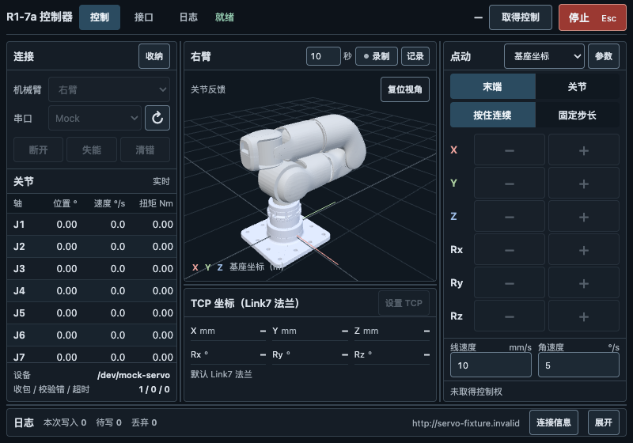

# R1-7a 控制器

宇树 R1-7a 七轴机械臂的桌面调试工具，基于 Rust 和 Tauri 2 开发。

- 串口连接与左右臂选择，查看关节位置、速度、扭矩和通信状态。
- 关节与末端点动，支持连续操作、固定步长，以及基座和工具坐标系。
- 加载官方 URDF 模型，根据关节反馈更新 3D 姿态。
- 提供本机 HTTP/WebSocket 接口，使用 SQLite 记录操作和运行日志。
- 在控制页录制短时控制、实际发送与反馈数据，下载 JSON 排查运动问题。
- 从控制页“点动 → 参数”打开伺服调试弹窗，逐轴调整阻尼、速度前馈权重与平滑摩擦补偿。
- 从控制页打开“校准”，先预览机械臂与末端路线，确认后逐轴辨识双向、多速度摩擦并比较同轨迹的前后表现。
- 从控制页打开“示教”，一键切换拖动或位置保持，独立录制实测轨迹，保存后查看 3D 路径并变速重放。



## 运行与构建

在 macOS arm64 上准备 Node.js/npm、Rust 工具链和 Xcode Command Line Tools，从仓库根目录运行：

```bash
npm ci
npm run tauri dev
```

开发命令同时启动 Vite 与 Tauri 后端；单独运行 `npm run dev` 只启动前端开发服务器。构建生产应用：

```bash
npm run tauri -- build --bundles app
```

默认构建输出：

```text
src-tauri/target/release/bundle/macos/R1-7a Controller.app
```

可用 `open "src-tauri/target/release/bundle/macos/R1-7a Controller.app"` 启动。

## 使用

选择左右臂和串口，取得控制后连接并使能。关节与末端点动共用一个操作区，一次执行一个动作。末端点动默认使用 Link7 法兰作为参考；安装工具后可再设置 TCP 偏移。默认串口波特率为 6 Mbps。

窗口支持 800×600。顶部可切换“控制”“接口”和“日志”；停止按钮在各页均可使用。点动按钮支持鼠标按住，也可聚焦后按住 Enter 或空格，松开结束连续点动。

点击点动面板的“参数”打开伺服调试弹窗，可编辑草稿、恢复基线、显式应用和复制配置 JSON。关闭后保留本次连接的草稿及上次编辑位置，控制页的坐标系、速度与 3D 视角保持原样。弹窗提供停止按钮，Esc 停止并关闭弹窗。

基线关闭摩擦补偿，每轴 `kd=10`、`velocity_ff=1`，摩擦系数为零。先连接再配置；应用需要当前控制权，运动、减速停止、使能确认或故障期间拒绝。参数只在当前连接的内存中生效，每次连接或断开恢复基线，不自动持久化。速度前馈权重仅改变报文速度字段，位置轨迹、TCP 路径及停止/收纳时序仍使用原始轨迹速度。完整参数范围与确认方式见[伺服调试配置](docs/implementation-contract.md#59-伺服调试配置)。

控制页点击“校准”生成轨迹预览。程序根据当前姿态、TCP 和关节范围计算基座 X、Y、Z 各方向的连续可达行程，也可指定单侧幅度和测试速度。3D 视图可按阶段播放末端路线，查看转向位置、肘腕扫过区域和单轮预计用时。每个关节围绕起始姿态往返，默认单侧最多 8°，靠近关节边界时自动缩短对应方向的行程。确认后，机械臂按预览生成的关节轨迹运行。

在 macOS 上，连接机械臂期间应用会向系统请求保持显示器点亮并防止闲置睡眠，断开或退出时释放。手动锁屏、合盖和强制锁定策略仍由 macOS 管理。[Apple 显示器电源接口](https://developer.apple.com/documentation/iokit/kiopmassertiontypepreventuseridledisplaysleep)

程序先记录末端三向往返，再通过逐轴正反向、多速度运动辨识 Stribeck 摩擦，默认速度为 1/2/4°/s，最后用所选补偿重复同一组末端运动。Kp、Kd 与速度前馈权重保持原值。结果直接列出改了哪些关节、参数的原值与推荐值，并显示同一末端路线下七轴位置和速度跟随的变化。正常完成回原位、恢复起始参数，点击“应用推荐”才采用结果。停止则取消后续动作、减速并恢复参数。

弹窗提供位置、速度、跟随误差曲线，以及基线/末端前后对照，支持旧报告导入。报告与完整时间曲线异步保存到 SQLite，保留最近 100 份。刚完成的报告可立即查看和下载，无需等待写盘；重启后从数据库读取。操作见[校准试用流程](docs/low-speed-calibration-test-plan.md)，输入输出见[校准接口](docs/implementation-contract.md#510-低速稳定性校准)。

控制页“示教”弹窗将运动模式与录制分开：点击“拖动示教”后可持续用手移动机械臂，点击“位置保持”则在当前位置平顺恢复保持，无需一直按着按钮；正常切换持续保留电机使能、重力补偿和当前阻尼。“开始录制”记录七轴实测位置，在保持、手动拖动、点动、步长、校准、收纳返回和轨迹重放期间均可使用，不改变正在执行的动作。可连续录制多次点动、停止和保持；停止按钮或 Esc 只停止机械臂，录制继续。点击“结束并保存”完成记录；若正在拖动，同时恢复位置保持，其他软件动作继续执行。关闭示教弹窗会结束并保存录制。

保存后可在“轨迹”页查看 3D 接近路线和录制路径，调整重放倍速与离线平滑，再执行重放。重放时也能另行录下实际运动，比较录制、规划指令和反馈曲线。完整记录异步保存到 SQLite，写入期间即可查看和下载。录制中可“收起”弹窗，回到控制页继续点动，再打开结束保存。操作与数据说明见[拖动示教](docs/teaching-test-plan.md)。

拖动面板之间的分隔线，可调整左右栏宽度、3D/末端坐标区高度和日志高度。双击分隔线恢复默认尺寸，调整结果自动保存。分隔线聚焦后可用方向键微调，Shift 加方向键加大步幅，Enter 还原。日志默认收起，可展开查看最近记录，或切到日志页搜索和翻页；面板空间不足时，内容在各自区域内滚动。

未连接时，关节数据和计算 TCP 显示为空，3D 显示参考姿态。连接后，模型随关节反馈更新。

连接区的“收纳”可记录当前实测关节位置，再限速返回，或在到位后断开。先将机械臂放在支撑上，再记录收纳位；左右臂与串口分别保存，没有预置角度。返回中可随时停止。保持连接的返回在指令到位后完成；到位断开另检查有效七轴位置在约 1.15° 容差内，不使用反馈速度判断。实际位置未到时继续保持使能，不按预计时长报告失败。已使能时，断开、失能和退出会先显示收纳或确认支撑的操作。突然断电后的保持仍需要机械支撑或制动机构。

## 本机接口与日志

接口默认监听 `127.0.0.1:8177`。顶部“接口”页提供地址和会话令牌、接口输入输出示例、请求结果，以及 OpenAPI 下载。可用“读取状态”查询实际 JSON 返回值。宽屏中接入信息与返回值并排显示，小窗口自动切为单列。请求字段、返回值和调用顺序见 [API 接入说明](docs/implementation-contract.md)，机器可读定义见 [OpenAPI 3.1](docs/openapi.json)。桌面操作和外部程序共用一份设备状态，同一时间由一个客户端持有控制权；释放后可由其他客户端取得。

工作台的停止按钮可取消任一客户端的当前动作，控制权和使能状态保持不变。

日志由后台线程写入 SQLite，重启后保留最近 100000 条。日志页可组合使用级别、来源、编号、起止时间与关键词，按每页 25、50 或 100 条查看匹配记录。第一页自动更新，翻页后保持当前记录范围，点击“最新”回到实时记录。“本次写入”是本次运行的提交数，筛选后的记录总数见分页栏。事件入队时只尝试一次取得队列锁，锁被占用或队列已满时丢弃并计数，后台写入失败单独计数。

控制页 3D 区域上方可设置录制时长并直接开始或停止，默认 10 秒，可输入正的录制时长。“记录”打开最近录制与下载弹窗，关闭弹窗不影响正在进行的录制。端口连接后即可采样，无需取得控制权；开始采样只观察现有连接。“停止录制”结束记录，机械臂动作由工作台的停止按钮取消。列表分别显示记录中、写入中、完成、失败，以及样本、写入、待写、丢弃和错误数；结束写入后可下载 JSON，包含控制参考、发送时对齐的理想目标、编码值和逐关节反馈。发送样本新增可空的 `timing`，记录对齐状态与源参考年龄；旧文件可以缺省。`seq` 仍指向源控制周期，同一序号的发送位置可以不同。采样保留最近 10 次，单独写入日志目录的 `events.sqlite3.traces.sqlite3`，不计入事件日志统计。

下载后可离线分析，命令只读取 JSON 文件并输出统计：

```bash
cargo run --manifest-path src-tauri/Cargo.toml --example analyze_trace -- /path/to/capture.json
```

输出包括来源间隔、参考速度/加速度/jerk 峰值、新鲜反馈的逐轴跟随 RMS、编码值与参考的最大差异、发送序号重复/跳过及完整性计数。新增 `tuning` 汇总配置版本与逐轴补偿限幅次数；速度编码差异优先比较 `tuning.dq_feedforward`，旧文件回退到 `dq_ref`，速度前馈权重为零不会被误算成编码误差。采集静止保持、低速与常用速度点动、停止等场景的操作顺序见[采样与验收流程](docs/implementation-contract.md#93-采样与验收流程)。

串口发送保持原始 10 ms 网格，跳过错过的槽位，不补发。发送端将速度对齐到当前发送时刻，再按相邻成功批次的实际间隔连续积分位置，避免切换控制参考时回跳。源参考超过 50 ms 时保持最近成功目标，新参考到达后继续，不因此结束整个动作。发送端保留目标与上下文有效期处理，移除了重复的路径残差拒绝。采样 JSON 的 `transmit.q_ref/dq_ref` 是对齐后的理想目标，`q_wire/dq_wire` 是报文编码后转回关节单位的值，详见[接口说明](docs/implementation-contract.md#58-发送时间对齐)。

关节、末端点动与收纳共用可编辑的运动设置：关节速度默认 1 rad/s，加速度 0.60 rad/s²，jerk 6 rad/s³。速度同时受模型各轴速度约束，末端速度按请求和当前 Jacobian 求解，不另设 15 mm/s 或 100 mm 行程上限。这些默认值是软件运动设置，可在参数弹窗调整。正常停止按导数约束减速；参考导数与实测运动分别记录。

本次范围与执行条件清理见 [运动设置说明](docs/motion-settings.md)，包含前后端参数、串口时序、校准与收纳的具体变化。

## 开发与测试

当前开发与测试平台为 macOS arm64，Windows 和 Linux 尚未测试。发送时间对齐版本 `799f759` 已由用户真机测试，运动仍有抖动。新增拖动示教与轨迹重放尚未真机验证；低速校准的实际减抖效果需要同条件前后对照。软件检查与构建结果见[测试记录](docs/implementation-status.md)，方案依据见[补偿方案调查](docs/research/motion-compensation-repositories-2026-11-21.md)。

个人自用项目，采用 vibe coding 方式开发。

检查命令：

```bash
npm run format:check
npm run build
cargo test --release --manifest-path src-tauri/Cargo.toml --all-targets --locked -- --test-threads=1
cargo clippy --manifest-path src-tauri/Cargo.toml --all-targets --locked -- -D warnings
cargo fmt --manifest-path src-tauri/Cargo.toml -- --check
```

相关文档：[功能规格](docs/spec.md)、[架构设计](docs/adr/0001-controller-architecture.md)、[原型记录](docs/prototype.md)。

## 许可与来源

采用 [BSD-3-Clause](LICENSE) 许可证，允许商用。

模型、示例标定和协议参考来自 [Unitree R1-7a SDK](https://github.com/unitreerobotics/r1-7a_sdk)，已保留宇树原始版权声明与许可证。来源、版本及第三方许可见 [THIRD_PARTY_NOTICES.md](THIRD_PARTY_NOTICES.md)。
