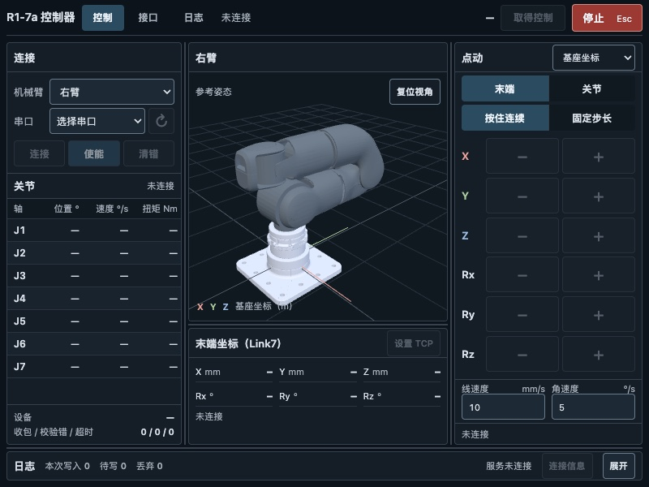

# R1-7a 控制器

宇树 R1-7a 七轴机械臂的桌面调试工具，基于 Rust 和 Tauri 2 开发。

- 串口连接与左右臂选择，查看关节位置、速度、扭矩和通信状态。
- 关节与末端点动，支持连续操作、固定步长，以及基座和工具坐标系。
- 加载官方 URDF 模型，根据关节反馈更新 3D 姿态。
- 提供本机 HTTP/WebSocket 接口，使用 SQLite 记录操作和运行日志。
- 在“日志 → 采样”记录短时控制、实际发送与反馈数据，下载 JSON 排查运动问题。



## 运行与构建

在 macOS arm64 上准备 Node.js/npm、Rust 工具链和 Xcode Command Line Tools，从仓库根目录运行：

```bash
npm ci
npm run tauri dev
```

开发命令同时启动 Vite 与 Tauri 后端；单独运行 `npm run dev` 只启动前端开发服务器。构建生产应用：

```bash
npm run tauri -- build --bundles app
```

默认构建输出：

```text
src-tauri/target/release/bundle/macos/R1-7a Controller.app
```

可用 `open "src-tauri/target/release/bundle/macos/R1-7a Controller.app"` 启动。

## 使用

选择左右臂和串口，取得控制后连接并使能。关节与末端点动共用一个操作区，一次执行一个动作。末端点动默认使用 Link7 法兰作为参考；安装工具后可再设置 TCP 偏移。默认串口波特率为 6 Mbps。

窗口支持 800×600。顶部可切换“控制”“接口”和“日志”；停止按钮在各页均可使用。点动按钮支持鼠标按住，也可聚焦后按住 Enter 或空格，松开结束连续点动。

拖动面板之间的分隔线，可调整左右栏宽度、3D/末端坐标区高度和日志高度。双击分隔线恢复默认尺寸，调整结果自动保存。分隔线聚焦后可用方向键微调，Shift 加方向键加大步幅，Enter 还原。日志默认收起，可展开或切到日志页筛选；面板空间不足时，内容在各自区域内滚动。

未连接时，关节数据和计算 TCP 显示为空，3D 显示参考姿态。连接后，模型随关节反馈更新。

连接区的“收纳”可记录当前实测关节位置，再限速返回，或在到位后断开。先将机械臂放在支撑上，再记录收纳位；左右臂与串口分别保存，没有预置角度。返回中可随时停止，未到位不会继续断开。已使能时，断开、失能和退出会先显示收纳或确认支撑的操作。突然断电后的保持仍需要机械支撑或制动机构。

## 本机接口与日志

接口默认监听 `127.0.0.1:8177`。顶部“接口”页提供地址和会话令牌、六个接口与十一种命令的输入输出示例、请求结果，以及 OpenAPI 下载。可用“读取状态”查询实际 JSON 返回值。宽屏中接入信息与返回值并排显示，小窗口自动切为单列。请求字段、返回值和调用顺序见 [API 接入说明](docs/implementation-contract.md)，机器可读定义见 [OpenAPI 3.1](docs/openapi.json)。桌面操作和外部程序共用一份设备状态，同一时间由一个客户端持有控制权；释放后可由其他客户端取得。

工作台的停止按钮可取消任一客户端的当前动作，控制权和使能状态保持不变。

日志由后台线程写入 SQLite。事件提交只尝试一次取得队列锁，竞争或满队列时立即丢弃并计数，不等待队列或磁盘；后台写入失败单独计数。

“日志 → 采样”默认记录 10 秒，可选 1–20 秒。端口连接后即可采样，无需取得控制权；开始采样只观察现有连接。“停止采样”结束记录，机械臂动作由工作台的停止按钮取消。列表分别显示记录中、写入中、完成、失败，以及样本、写入、待写、丢弃和错误数；结束写入后可下载 JSON，包含控制参考、编码后的发送值和逐关节反馈。采样保留最近 10 次，单独写入日志目录的 `events.sqlite3.traces.sqlite3`，不计入事件日志统计。

下载后可离线分析，命令只读取 JSON 文件并输出统计：

```bash
cargo run --manifest-path src-tauri/Cargo.toml --example analyze_trace -- /path/to/capture.json
```

输出包括来源间隔、参考速度/加速度/jerk 峰值、新鲜反馈的逐轴跟随 RMS、编码值与参考的最大差异、发送序号重复/跳过及完整性计数。采集静止保持、低速与常用速度点动、停止等场景的操作顺序见[采样与验收流程](docs/implementation-contract.md#93-采样与验收流程)。

关节、末端点动与收纳返回的控制参考增加 jerk 限制，当前离线默认值为 6 rad/s³，关节速度与加速度上限仍为 0.20 rad/s、0.60 rad/s²。正常停止按这些约束减速，可能需要更长时间；故障、失能和关闭继续优先处理。约束针对控制器积分的参考序列，USB/串口可能重复或合并参考更新，实际发送与机械臂运动的 jerk 需结合采样和真机测量确认。

末端接近全局速度上限时预留 10% 目标余量，即平移 13.5 mm/s、旋转 0.135 rad/s；低于这两个阈值的请求不因该余量额外缩放。最终 FK 仍检查 15 mm/s、0.15 rad/s 的硬上限。路径偏差阈值 50 μm、0.002 rad 用于模型候选检查，实际精度待真机测量。

## 开发与测试

个人自用项目，采用 vibe coding 方式开发。

本轮 108 项 Rust 测试（104 项库测试、4 项离线分析示例测试）、Clippy、格式检查、macOS arm64 Tauri 应用构建，以及采样和收纳的隔离界面检查通过，详细结果见[测试记录](docs/implementation-status.md)。新轨迹与采样尚未真机验证。此前真机串口连接与七轴反馈已在本机验证；本体标定、方向、TCP、使能、连续运动平滑性、姿态保持、停止和失联行为仍未验收，收纳返回与退出流程也尚未做真机验收。Windows 和 Linux 尚未测试。

检查命令：

```bash
npm run format:check
npm run build
cargo test --manifest-path src-tauri/Cargo.toml --all-targets --locked
cargo clippy --manifest-path src-tauri/Cargo.toml --all-targets --locked -- -D warnings
cargo fmt --manifest-path src-tauri/Cargo.toml -- --check
```

相关文档：[功能规格](docs/spec.md)、[架构设计](docs/adr/0001-controller-architecture.md)、[原型记录](docs/prototype.md)。

## 许可与来源

采用 [BSD-3-Clause](LICENSE) 许可证，允许商用。

模型、示例标定和协议参考来自 [Unitree R1-7a SDK](https://github.com/unitreerobotics/r1-7a_sdk)，已保留宇树原始版权声明与许可证。来源、版本及第三方许可见 [THIRD_PARTY_NOTICES.md](THIRD_PARTY_NOTICES.md)。
