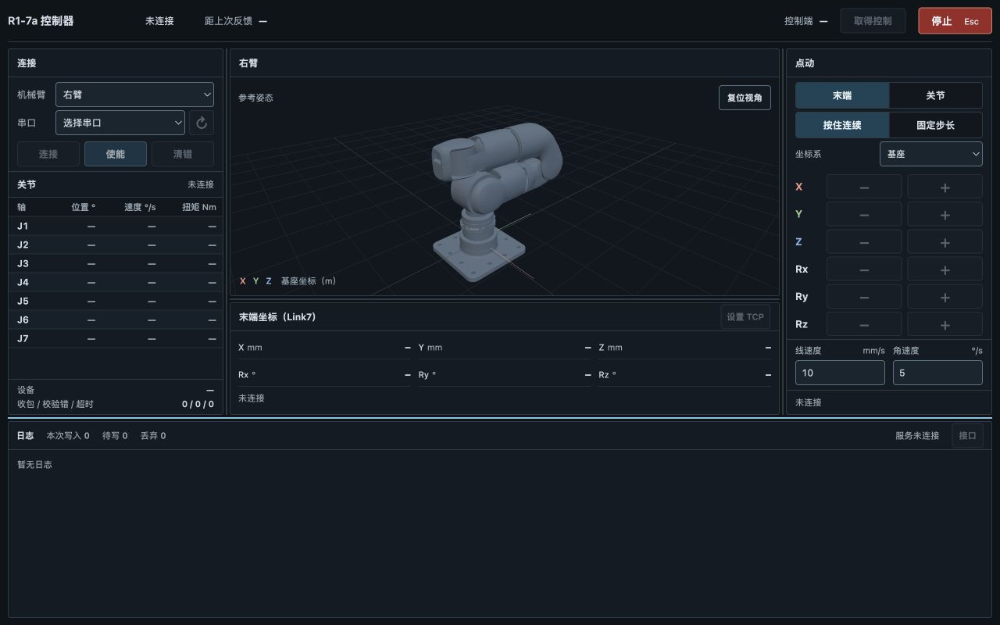

# R1-7a 控制器

宇树 R1-7a 七轴机械臂的桌面调试工具，基于 Rust 和 Tauri 2 开发。

- 串口连接与左右臂选择，查看关节位置、速度、扭矩和通信状态。
- 关节与末端点动，支持连续操作、固定步长，以及基座和工具坐标系。
- 加载官方 URDF 模型，根据关节反馈更新 3D 姿态。
- 提供本机 HTTP/WebSocket 接口，使用 SQLite 记录操作和运行日志。



## 运行与构建

在 macOS arm64 上准备 Node.js/npm、Rust 工具链和 Xcode Command Line Tools，从仓库根目录运行：

```bash
npm ci
npm run tauri dev
```

开发命令同时启动 Vite 与 Tauri 后端；单独运行 `npm run dev` 只启动前端开发服务器。构建生产应用：

```bash
npm run tauri -- build --bundles app
```

默认构建输出：

```text
src-tauri/target/release/bundle/macos/R1-7a Controller.app
```

可用 `open "src-tauri/target/release/bundle/macos/R1-7a Controller.app"` 启动。

## 使用

选择左右臂和串口，取得控制后连接并使能。关节与末端点动共用一个操作区，一次执行一个动作；末端点动前需设置 TCP。默认串口波特率为 6 Mbps。

拖动面板之间的分隔线，可调整左右栏宽度、3D/末端坐标区高度和日志高度。双击分隔线恢复默认尺寸，调整结果自动保存。分隔线聚焦后可用方向键微调，Shift 加方向键加大步幅，Enter 还原。关节表和点动列表在各自区域内滚动。

未连接时，关节数据和计算 TCP 显示为空，3D 显示参考姿态。连接后，模型随关节反馈更新。

## 本机接口与日志

接口默认监听 `127.0.0.1:8177`。在工作台底部的“接口”中查看地址和会话令牌，调用方式见[接口说明](docs/implementation-contract.md)。桌面操作和外部程序共用一份设备状态，同一时间由一个客户端持有控制权；释放后可由其他客户端取得。

工作台的停止按钮可取消任一客户端的当前动作，控制权和使能状态保持不变。

日志由后台线程写入 SQLite，控制线程通过有界队列提交事件，不等待磁盘。队列满和写入失败分别计数。

## 开发与测试

个人自用项目，采用 vibe coding 方式开发。

已在 macOS arm64 完成构建、48 项离线测试和界面检查。真机尚未验收，待测试项目包括串口与转接器、本体标定、运动跟随、停止和失联行为。Windows 和 Linux 尚未测试。详细结果见[测试记录](docs/implementation-status.md)。

检查命令：

```bash
npm run format:check
npm run build
cargo test --manifest-path src-tauri/Cargo.toml --lib --locked
cargo clippy --manifest-path src-tauri/Cargo.toml --all-targets --locked -- -D warnings
```

相关文档：[功能规格](docs/spec.md)、[架构设计](docs/adr/0001-controller-architecture.md)、[原型记录](docs/prototype.md)。

## 许可与来源

采用 [BSD-3-Clause](LICENSE) 许可证，允许商用。

模型、示例标定和协议参考来自 [Unitree R1-7a SDK](https://github.com/unitreerobotics/r1-7a_sdk)，已保留宇树原始版权声明与许可证。来源、版本及第三方许可见 [THIRD_PARTY_NOTICES.md](THIRD_PARTY_NOTICES.md)。
