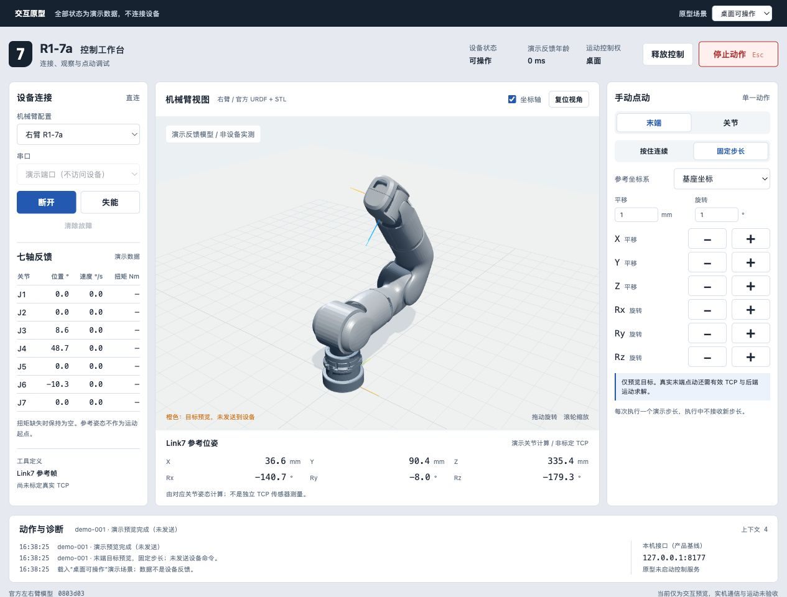

# 工作台原型记录

日期：2026-11-09。本页记录早期工作台的布局和交互检查，使用演示数据。当前应用的运行方式见[README](../README.md)，测试结果见[测试记录](implementation-status.md)，功能和接口见[规格](spec.md)及[接口说明](implementation-contract.md)。

原型采用三栏布局，用于前端的交互和视觉评审。当前应用已调整为 1280×720 与 1024×768 下各模块同时可见的紧凑布局。

## 布局与信息层级

| 位置 | 固定内容 |
|---|---|
| 顶部 | 状态、反馈时效、当前控制者、取得/释放控制、总停止 |
| 左栏 | 当前设备配置、连接/使能、七轴位置/速度/扭矩与故障 |
| 中央 | 官方机械臂 3D、参考/演示反馈/目标来源标识、末端参考坐标系 |
| 右栏 | 末端/关节页签、连续/步长、基座/工具、速度/步长、禁用原因 |
| 底部 | 当前动作、有限诊断及本机接口信息 |

界面以桌面窗口为主要目标：宽屏保留三栏，较窄窗口保持关键操作可达。机械臂视图支持旋转、缩放与复位视角。颜色之外仍有文字区分参考、演示反馈、目标和过期数据。

## 交互检查

- 未连接：显示参考模型，关节实测和计算 TCP 为空。
- 桌面操作：显式取得控制并使能后方可点动；关节和末端操作互斥。
- 连续操作：释放、失焦和隐藏页面取消演示动作；固定步长不排队。
- 外部持有：桌面点动禁用；桌面停止可以取消外部动作，保留外部控制权且不自动失能。
- 反馈过期或故障：停止当前动作并显示原因，禁止继续点动；清理故障不恢复旧动作。

## 原型范围

原型以固定标识说明“原型／演示数据”，场景选择仅属于评审工具。全部状态保存在内存，不枚举真实串口、不连接真实 server、不发送设备报文。

官方 URDF 和 STL 用于视觉核对。关节操作可以改变演示模型；末端操作仅预览目标，不实现或验证 IK/闭环跟随。工具未知时展示 Link7 参考帧，不标为已经标定的 TCP。原型代码不作为正式控制逻辑复用。

末端目标预览用于评审画面，不代表产品的 TCP 有效性门槛已经满足。产品按动作分别校验配置：关节点动不依赖工具定义，末端点动额外要求有效 TCP。

## 运行与检查记录

历史原型是独立的交互评审产物，未纳入本仓库的产品源码。下表和页面末尾截图保留当时的评审结果；当前软件的运行与构建以 [README](../README.md) 为准。

已完成本机 HTTP 浏览器检查：

| 检查 | 观察到的结果 |
|---|---|
| 未连接 | 七轴和位姿为空，模型标注为参考，运动按钮禁用 |
| 连接与使能 | 先取得控制，再连接和显式使能；连接不自动使能 |
| 关节步长 | J1 正向 1° 后显示 1.0°，三维演示姿态随之更新 |
| 连续关节点动 | 按住时变化，松开后记录 cancelled，速度回零 |
| 外部动作的桌面停止 | 取消外部动作，控制权仍为外部，失能按钮的当前状态保持 |
| 反馈过期 | 关节数据标过期，计算位姿为空，点动禁用 |
| 清除故障 | 回到已连接未使能，不自动恢复动作 |
| 左右臂模型 | 两侧分别加载自己的 8 个官方 STL，左臂未用右臂镜像替代 |
| 末端目标预览 | 工具坐标步长显示橙色目标，演示关节值不伪装成 IK 跟随 |
| 布局 | 1300×900 三栏；860×900 重排，无横向溢出；状态与停止栏保持可达 |
| 最终构建 | npm 构建成功，最后一次页面启动未产生新的 warning/error |

上述检查使用本机 HTTP 预览。直接打开本地文件未完成测试。

Rust 后端、本机 API、串口与运动学的测试记录见[测试记录](implementation-status.md)。

