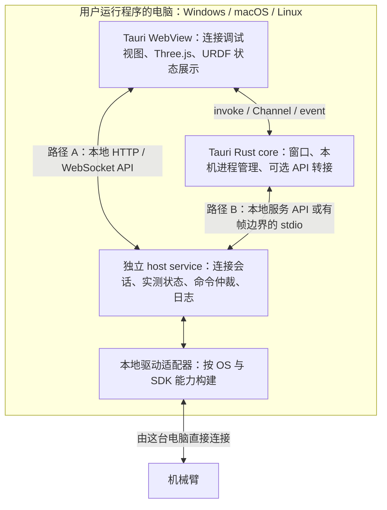

# Tauri 2：本机机械臂调试、headless host service 与实测关节 3D 的技术边界

调研日期：**2026-11-09（Asia/Shanghai）**。状态：技术方案与待验证地图，**未锁定 UI、服务语言、通信协议或驱动实现**。

当前范围更新（2026-11-09）：首版随桌面启停，只供本机调用，取消未来能力预留。本记录关于无窗口服务、局域网扩展和多种适配形式的讨论属于先期备选调研，不是当前需求；当前方案以[规格](../spec.md)和[架构决策](../adr/0001-controller-architecture.md)为准。

本轮约束：Windows、macOS、Linux 均要求由运行程序的那台电脑直接连接机械臂；不以 Linux 网关替代任何平台的本机连接。首版 3D 只把实测关节状态同步到 URDF，不包含相机、视频或 UI 实现。SDK 的平台支持、ABI 和实际连接能力由主任务另行核实，本报告不重复 R1 SDK 调研，也不把未知平台视为已经支持。

方法：采用 Tauri v2 官方文档、Three.js 官方资料、gkjohnson/urdf-loaders 上游及 MoveIt/Pinocchio 一手资料。文中“事实”指来源明确描述的能力；“推论／建议”是针对本项目的工程判断；“未知”需要版本核实或实机验证。本报告编写时未运行 SDK、Tauri 或 3D 性能实验；后续实施结果见[测试记录](../implementation-status.md)。

## 1. 主要主张与证据边界

| 编号 | 主张 | 判断性质与依据 | 尚不能据此认定的内容 |
| --- | --- | --- | --- |
| C1 | Tauri `invoke`、event、Channel 属于 WebView 与 Rust core 的应用内 IPC；headless 服务的 API 需要另行定义。 | 事实＋架构推论。[Tauri IPC](https://v2.tauri.app/concept/inter-process-communication/)、[core API](https://v2.tauri.app/reference/javascript/api/namespacecore/) | `invoke` 不是供任意外部客户端访问的 HTTP 接口；“API 类似 fetch”不表示已经启动网络服务器。 |
| C2 | event 适合连接变化等少量通知；持续遥测可评估 Channel。 | 事实：官方明确 event 不面向低延迟／高吞吐，Channel 提供有序流。[调用前端](https://v2.tauri.app/develop/calling-frontend/) | Channel 不等于硬实时控制链路；所读资料没有给出本项目可承诺的 Hz、p99 延迟或背压上限。 |
| C3 | C++ 可执行文件可以按 sidecar 方式随 Tauri 分发，构建与依赖闭包仍是独立工作。 | 事实＋推论：`externalBin` 嵌入预先准备的可执行文件，要求匹配目标 triple。[sidecar](https://v2.tauri.app/develop/sidecar/) | Tauri 不会把 Linux C++ 二进制或仅支持 Linux 的 SDK 自动变成 Windows/macOS 驱动。 |
| C4 | Three.js＋URDFLoader 可以承担实测关节驱动的可视化；需要目标 WebView 的 WebGL 2 实测。 | 事实＋推论。[WebGLRenderer](https://threejs.org/docs/pages/WebGLRenderer.html)、[URDFLoader API](https://github.com/gkjohnson/urdf-loaders/blob/c8c25c8cf6fcb84929b9a03ff866139a8a1e2a01/javascript/API.md) | 支持 URDF 或成功创建 WebGL2 context，均不证明帧率、显示时延或模型标定正确。 |
| C5 | 可优先设计“每个平台的本机 host service＋本地驱动适配器”，将 UI 生命周期与连接生命周期分开。 | 工程建议，依据 Tauri 的进程隔离模型及 GUI 调度限制。[进程模型](https://v2.tauri.app/concept/process-model/)、[后台节流配置](https://v2.tauri.app/reference/config/#backgroundthrottling) | 这是架构可移植性；各 OS 的机械臂实连接能力仍取决于尚未确认的本地驱动。 |

## 2. 建议的本机架构地图

下图是**分别部署到 Win/mac/Linux 的同一逻辑边界**。A、B 为可比较的客户端通信路径，无需同时实现；图中不含另一台 Linux 网关。



**建议的职责划分（推论）**：

- **host service** 持有唯一设备连接与权威实测状态，管理驱动线程、连接状态、命令 ID／结果、超时和日志。网络发布与 UI 慢消费者不能阻塞驱动读取或控制任务。
- **本地驱动适配器** 隐藏 SDK 的句柄、线程及平台差异，向服务提供连接／断开、读取状态、查询能力、提交支持的命令等接口；按平台编译对应实现。缺少已验证驱动时明确报告不可用，不伪装成已连实机。
- **Tauri Rust core** 负责桌面壳与本机启动体验。可转接 API，但设备业务不依赖 `AppHandle`、窗口或 JS 回调才能运行。
- **3D 客户端** 消费实测快照，更新 URDF 关节并显示状态年龄；服务不向 UI 逐帧发送 mesh、场景树或渲染结果。

这样，同一个服务程序可由终端独立启动，也可作为桌面包的随附进程启动。前者满足 headless 场景，后者改善本机调试启动体验。此为建议的产品拆分：Tauri 官方描述的 core 仍承担窗口和 IPC 编排，Linux 开发依赖包含 WebKitGTK；“不显示窗口”不足以证明一个 Tauri GUI 构建已经成为无显示环境的服务程序。[进程模型](https://v2.tauri.app/concept/process-model/)、[前置依赖](https://v2.tauri.app/start/prerequisites/)

服务语言应在 SDK 事实明确后选择：若 SDK 是 C++，C++ host 可减少语言边界；若采用 Rust host，则需设计 C ABI 或本机 C++ 适配进程。后者增加一层消息与生命周期管理。这些是实现取舍，目前不据此选定 C++ 或 Rust。

| 运行平台 | 桌面展示环境 | 本机服务／驱动要求 | 当前直连结论 |
| --- | --- | --- | --- |
| Windows | Tauri 使用 Chromium 系 WebView2。 | Windows host＋可在 Windows 运行的本地驱动；本机连接机械臂。 | SDK 支持、架构与实连接未知。 |
| macOS | Tauri 使用 WKWebView，WebKit 随系统更新。 | macOS host＋对应 CPU 架构的本地驱动；本机连接机械臂。 | SDK 支持、架构与实连接未知。 |
| Linux | Tauri 使用 WebKitGTK，另需检查图形栈。 | Linux host＋本地驱动；本机连接机械臂。 | SDK 兼容组合及实连接仍需主任务确认。 |

WebView 平台差异来自 [Tauri Webview Versions](https://v2.tauri.app/reference/webview-versions/)。表中服务／驱动要求是本项目约束，不是官方 SDK 支持声明。**若某 OS 没有满足需求的本地驱动，该平台直连目标就是未满足，不能用另一台 Linux 机器代替验收。**

## 3. IPC 与网络 API：相似写法不代表相同边界

| 通道 | 实际通信边界与语义 | 在本项目中的候选用途 | 需由项目补齐 |
| --- | --- | --- | --- |
| `invoke` | 前端调用注册的 Rust command，异步接收返回值／错误；通常使用可序列化参数。 | 本机设置、进程管理、离散操作；或薄层转接服务 API。 | 超时、取消、幂等、命令结果状态；调用成功与机械臂动作完成分开。 |
| event | 应用内单向、发送后不等待业务结果的通知；可从两端发出并选择目标窗口。 | 已连接／断开、能力变化、低频告警。 | 避免把高频状态、命令确认和可靠历史记录混为一条广播流。 |
| Channel | Rust 向前端流式发送数据；前端创建对象并作为 command 参数传入。 | 经 Rust core 转接的遥测或日志流。 | 订阅取消、窗口刷新后的重建、队列界限、慢消费者策略。 |
| 本地服务 API，例如 HTTP＋WebSocket | 独立 host service 自己监听端点，Tauri 和终端客户端访问它。 | 连接／查询等离散操作与状态订阅；无 UI 启动、录制／回放工具复用。 | 协议版本、访问控制、端点发现、重连、单一控制权和应用级确认。 |
| stdio | 父子进程管道；不是 Tauri IPC，也不是通用网络 API。 | UI 启动的私有 helper，或服务与隔离适配器的本机通信。 | 消息分帧、请求 ID、输出限额；stdout 协议与 stderr 日志分离。 |

前三行依据 [Calling Rust](https://v2.tauri.app/develop/calling-rust/)、[Calling Frontend](https://v2.tauri.app/develop/calling-frontend/) 与 [Channel API](https://v2.tauri.app/reference/javascript/api/namespacecore/#channel)；stdio 能力依据 [Shell API](https://v2.tauri.app/reference/javascript/shell/)。用途与补齐项为建议。

需要避免两个过度简化：

- **不能笼统说 Tauri 所有数据都只能 JSON。** command 文档支持 `ArrayBuffer`／`Uint8Array` 原始请求和 `ipc::Response` 原始响应；当前 Channel API 也说明 raw bytes 可作为前端 `ArrayBuffer` 交付。关节小快照可先用易检查的结构化数据，是否改二进制由测量决定。[原始请求与响应](https://v2.tauri.app/develop/calling-rust/)、[Channel 原始字节](https://v2.tauri.app/reference/javascript/api/namespacecore/#channel)
- **不能把 Channel 的有序交付当作实时性或业务处理完成。** 官方说明其保持发送顺序，但未在所读文档承诺本项目需要的延迟界限、持久化、自动重放或业务 ACK。event API 的使用权限可以管理，具体事件名称／载荷的细粒度授权则不是自动具备的能力。[IPC 权限](https://v2.tauri.app/concept/inter-process-communication/)、[event／Channel 边界](https://v2.tauri.app/develop/calling-frontend/)

### 3.1 两条本地网络访问路径均可评估

**路径 A：WebView 原生 `fetch`／`WebSocket` 访问本地服务。** 前端更容易复用到普通浏览器，但需要核实实际页面 Origin、HTTP CORS、WebSocket Origin 校验、CSP 和混合内容行为。Tauri 官方配置说明 Windows 的自定义协议可采用 `http(s)://<scheme>.localhost`，macOS/Linux 则不同；启用 HTTPS scheme 会影响对 HTTP 端点的访问。因此不能只在开发服务器验证一次就认定安装包可用。[协议 scheme](https://v2.tauri.app/reference/config/#usehttpsscheme)、[CSP](https://v2.tauri.app/security/csp/)

**路径 B：Rust core／官方网络插件访问服务，再交给前端。** `@tauri-apps/plugin-http` 的请求在 Rust 后端执行，官方明确不受 WebView CORS 限制，但 URL 必须在插件 scope 内；官方 WebSocket 插件同样使用 Rust 客户端。它们是网络**客户端**，不会替 C++ 服务创建 HTTP／WebSocket server。代价是增加一次壳内转接，普通浏览器需要另一套客户端适配。[HTTP API](https://v2.tauri.app/reference/javascript/http/)、[WebSocket 插件](https://v2.tauri.app/plugin/websocket/)

以上认证与 Origin 校验是本地端点设计建议；CORS 或 Tauri capability 本身不替服务完成命令授权。优先比较同一业务协议在 A/B 路径的可用性、队列增长和延迟，再决定是否需要二进制或绕过 Rust 转发，当前不锁定 HTTP/WS。

## 4. 外置 C++ sidecar：打包、运行与服务生命周期

### 4.1 已确认的能力

`bundle.externalBin` 指向预构建可执行文件，需准备带目标 triple 后缀的文件，Windows 还带 `.exe`。例如 macOS ARM64 与 Linux x86_64 对应不同产物。host 的 C++ 编译、依赖库和 SDK 产物由自己的构建链提供；改文件名不能完成交叉编译。[Embedding External Binaries](https://v2.tauri.app/develop/sidecar/)

当前文档还有容易接错的命名差异：Rust `app.shell().sidecar(...)` 使用文件名，JS `Command.sidecar(...)` 使用与 `externalBin` 项一致的字符串。JS 调用 `spawn`／`execute` 需要对应 shell 权限与参数 scope。[sidecar 调用规则](https://v2.tauri.app/develop/sidecar/)

Shell API 提供 `spawn`、stdout/stderr、`close`／`error`、stdin 写入与 `Child.kill()`；长期运行服务宜用 `spawn`。`execute` 收集进程结束结果，不宜作为常驻服务的就绪检测。当前 `SpawnOptions.processGroup` 可使用 POSIX process group／Windows job object，使 `kill()` 涵盖进程树，默认关闭；选定插件版本后仍需确认该选项可用。[Shell API](https://v2.tauri.app/reference/javascript/shell/)

### 4.2 生命周期建议：明确谁拥有进程

| 模式 | 启动／退出规则建议 | 适用性与代价 |
| --- | --- | --- |
| 桌面启动、桌面拥有的 sidecar | Rust core 持有 child；等待就绪握手；退出前请求服务停止／释放连接，等待确认，再超时终止进程。 | 启动方便；与桌面生命周期关联，不承诺 UI 退出后继续运行。 |
| 独立启动的 headless host service | 终端或系统进程管理器拥有服务；UI 只连接／断开客户端会话，不终止并非由它拥有的服务。 | 无需 UI 即可运行；另需服务安装、升级与管理设计。 |

这里的“host service”首先指独立可执行服务进程，不预设首版必须注册为 Windows Service 或系统 daemon。相同设备业务与 API 可复用，两种启动模式的进程所有权必须显式区分。

建议服务启动先发布协议版本、驱动能力、模型标识和 ready 状态。`spawn` 成功只证明创建了进程；进程退出、驱动连接成功、实测反馈有效是不同状态。重连后重新获取完整快照，不继承旧连接的未完成运动命令。若 UI 因隐藏或崩溃失联，服务按自己的会话／命令超时规则处理；这不依赖前端定时器。

**未知／不可假设**：所读 v2 文档没有给出“父进程任意崩溃或被强杀时，所有 sidecar 后代均被跨平台可靠清理”的完整约定。正常关闭、core 崩溃、WebView 崩溃、强杀、挂起恢复及子进程树应分别验证。`kill()` 是进程终止手段，不表示机械臂已经反馈停止；需要由服务与设备连接约定确定结果。[Shell 的明确 API 边界](https://v2.tauri.app/reference/javascript/shell/)

### 4.3 跨平台包需要交付什么

| 平台 | 官方打包事实 | 本项目的额外验证建议 |
| --- | --- | --- |
| Windows | 安装器可选择 WebView2 在线／离线安装或固定 runtime，并可配置最低 WebView2 版本。[Windows Installer](https://v2.tauri.app/distribute/windows-installer/) | 逐目标架构准备 host `.exe`、SDK DLL 与运行库；在无开发环境的机器验证从 UI／终端直接连接。固定 WebView2 不解决 SDK 兼容。 |
| macOS | bundle 可嵌入 frameworks/dylib；GUI 不继承 shell dotfiles 的 PATH。[App Bundle](https://v2.tauri.app/distribute/macos-application-bundle/)；分发涉及签名／公证。[签名](https://v2.tauri.app/distribute/sign/macos/) | 区分 Intel/Apple Silicon；检查依赖架构、动态库装载路径和最终签名包。若选择 universal，依赖和 sidecar 的双架构可用性也要验证。 |
| Linux | AppImage 仍有 glibc 基线限制；官方建议以提供 WebKitGTK 4.1 依赖的最老目标系统构建；ARM AppImage 不支持直接交叉构建。[AppImage](https://v2.tauri.app/distribute/appimage/) | 验证 host 与 SDK 的 `.so` 依赖、权限及目标环境；UI 另验 X11/Wayland 与 GPU。headless 服务包应有独立依赖清单。 |

URDF、mesh、配置与驱动依赖也要进入资源／安装清单；Tauri 提供 `bundle.resources` 与运行时资源路径解析，但复制文件本身不证明动态库装载和 SDK 运行成功。[资源打包](https://v2.tauri.app/develop/resources/)

## 5. 首版 3D：实测状态到 URDF，同步能力与模型真实性分开

### 5.1 最小数据路径与约定建议

```text
本机驱动读取实测关节
  → host service 验证／转换为模型关节状态
  → 发布带序号、时间与模型标识的完整快照
  → 客户端保留最新有效状态
  → robot.setJointValues(按关节名称的字典)
  → Three.js 渲染循环
```

URDFLoader 上游支持按关节名设置值；角度单位为弧度、平移为米，也支持 mimic 关节。它构建 Three.js 模型，不能由此推出设备连接、物理仿真或运动控制能力。[上游 API](https://github.com/gkjohnson/urdf-loaders/blob/c8c25c8cf6fcb84929b9a03ff866139a8a1e2a01/javascript/API.md)

建议服务快照至少携带 `schema_version`、`model_id/hash`、`session_id`、`sample_seq`、采样时间及其时钟域、服务接收时间、关节名称／实测位置、单位约定和有效性。若设备没有可信采样时间，应标记未知并区分 host 接收时间；不同进程的时间戳未经时钟基准核实不能直接相减。运动目标值不能冒充实测值。

映射中显式处理关节名、轴方向、零位偏置、角度展开／取模、基座与工具变换；这些依赖模型及设备标定，当前未验证。缺失关节不可默认为零；旧快照不可继续标成实时。首版可先按最新完整实测快照显示，不要求预测或平滑；若后续加入插值，应区分原始采样状态与显示处理。

驱动采样、遥测发布和渲染使用独立节奏；例如发布 30–60 Hz、显示尽量接近 60 FPS 可作为**实验起点**，均非需求承诺，也不假设 SDK 能提供该采样率。采用有界最新快照策略，慢 UI 可跳过中间状态；原始数据若需完整记录，应在服务端另行存储。动画循环可使用官方推荐的 `renderer.setAnimationLoop()`。[Three.js 渲染循环](https://threejs.org/docs/pages/WebGLRenderer.html#setAnimationLoop)

### 5.2 URDFLoader 的三个具体接入边界

1. **模型路径不是 OS 文件路径的直接照搬。** 上游用 `packages` 映射 `package://`，用 `workingPath` 解析 mesh 相对路径，并通过 fetch／Three.js loader 取资源。建议先将 URDF 与 mesh 作为固定版本资源分发；运行时打开本地模型时需统一 URL 解析。Tauri `convertFileSrc` 还要求启用 asset protocol、配置 scope 与相应 CSP。[URDFLoader 源码](https://github.com/gkjohnson/urdf-loaders/blob/c8c25c8cf6fcb84929b9a03ff866139a8a1e2a01/javascript/src/URDFLoader.js)、[asset URL](https://v2.tauri.app/reference/javascript/api/namespacecore/#convertfilesrc)
2. **模型解析完成不等于全部 mesh 已加载。** 上游 API 单独说明 geometry 的异步完成；缺失 mesh 应形成可诊断结果。默认 loader 导入 STL／Collada，其他格式通过自定义 mesh loader 处理。[API](https://github.com/gkjohnson/urdf-loaders/blob/c8c25c8cf6fcb84929b9a03ff866139a8a1e2a01/javascript/API.md)、[加载实现](https://github.com/gkjohnson/urdf-loaders/blob/c8c25c8cf6fcb84929b9a03ff866139a8a1e2a01/javascript/src/URDFLoader.js)
3. **实测展示要检查限位钳制。** 当前 `URDFJoint` 默认 `ignoreLimits=false`，设置 revolute/prismatic 值时会按模型限位钳制。若实际反馈越界，直接展示可能掩盖差异。建议诊断模式保留原始数值，明确决定是否只对渲染对象忽略限位，并独立标示模型限位异常；这不改变服务的命令检查。[URDFClasses 实现](https://github.com/gkjohnson/urdf-loaders/blob/c8c25c8cf6fcb84929b9a03ff866139a8a1e2a01/javascript/src/URDFClasses.js)

本次核实上游 `master` 对应 `c8c25c8cf6fcb84929b9a03ff866139a8a1e2a01`，其 JS 包声明 `urdf-loader` 为 `0.13.1`、peer Three.js `>=0.152.0`。这只是所读源码快照，不证明所有更高 Three.js 版本都兼容。建议锁定验证组合；自定义 loader 的签名以选定版本源码为准。[package.json](https://github.com/gkjohnson/urdf-loaders/blob/c8c25c8cf6fcb84929b9a03ff866139a8a1e2a01/javascript/package.json)

### 5.3 WebView WebGL 限制与降级

当前 Three.js `WebGLRenderer` 使用 WebGL 2，自 r163 起不再支持 WebGL 1；官方提供 `WebGL.isWebGL2Available()` 检测。Tauri 的三种桌面 WebView 并非统一随应用发布的 Chromium，因此普通 Chrome demo 成功不足以完成桌面包验证。[WebGLRenderer](https://threejs.org/docs/pages/WebGLRenderer.html)、[能力检测](https://threejs.org/docs/pages/WebGL.html)、[Tauri WebView](https://v2.tauri.app/reference/webview-versions/)

Linux 是需要单独验证的组合：官方记录了 WebKitGTK／GPU 驱动导致白屏、调整窗口崩溃，以及 WebGL2 context 成功但落到慢路径的情形；禁用某些图形路径的 workaround 也有性能代价。因此应在真实模型、目标 GPU、显示协议和正式安装包上记录帧时间与交互延迟，不能只检查 context 创建。[Linux Graphics Issues](https://v2.tauri.app/develop/debug/linux-graphics/)

建议预留关节数值／连接状态的非 WebGL 展示，在 3D 不可用或过慢时仍能调试连接。替换模型时释放 geometry、material、texture 和 renderer 资源，避免长期运行的 GPU 资源累积；Three.js 要求应用显式 `dispose`。验证 context 丢失／恢复、最小化／恢复、缩放和高 DPI；有扩展支持时可用 `forceContextLoss/Restore` 辅助验证。[Cleanup](https://threejs.org/manual/pages/cleanup.html)、[Renderer 生命周期 API](https://threejs.org/docs/pages/WebGLRenderer.html)

## 6. 独立服务进程的收益、代价与实时边界

以下为工程推论：

- **UI 可重启，设备会话由服务处理。** 窗口关闭或 3D 异常不应直接成为设备连接实现的一部分；是否允许会话持续、是否停止当前命令由服务的显式策略决定。Tauri 的多进程隔离说明为这一拆分提供依据，但不能消除系统级资源竞争。[进程模型](https://v2.tauri.app/concept/process-model/)
- **headless 与桌面共用同一连接业务。** 终端可做连接诊断、状态录制和回放；各 OS 只替换本地驱动与进程启动集成。额外代价是协议版本、端点发现、安装升级与访问控制。
- **慢渲染不阻塞驱动。** 有界遥测队列让显示负载与设备任务解耦；但独立进程不自动获得实时调度、无抖动或更低延迟，需要实际测量。
- **平台限制更容易暴露。** host 报告实际驱动能力，防止 UI 的“跨平台可启动”被误判为“跨平台可控制实机”。如果 SDK 限制不满足某 OS，本轮应记录阻碍，留待用户决定后续取舍。

Tauri 配置文档说明隐藏／最小化的 WebView 存在后台节流，而其调整开关并非所有桌面平台支持。因此设备看门狗、命令超时和必要的周期任务应属于服务／驱动，不能依赖 3D 页面持续执行。[后台节流](https://v2.tauri.app/reference/config/#backgroundthrottling)

**MoveIt Servo 与 Pinocchio 不应成为首版状态显示的隐含前提。** Servo 面向运动伺服，提供 C++ core 与 ROS 接口；官方讨论低抖动 Linux 内核、调度优先级，并要求模型、控制器和快速准确反馈。其 C++ API 可以减少 ROS 通信开销，但示例仍使用 ROS node／planning scene 等组件，不能据此宣称它是零 ROS 依赖、Win/mac 即装即用的库。本轮仅 URDF 状态展示，无需把 Servo 集成进 host。[MoveIt Servo](https://moveit.picknik.ai/main/doc/examples/realtime_servo/realtime_servo_tutorial.html)

Pinocchio 上游提供运动学／动力学算法；其 IK 示例将 `forwardKinematics`、Jacobian 和迭代求解分别调用，也显式处理不收敛。后续可将其用于独立的 FK 对照或算法模块，不应把算法库等同于设备驱动、服务管理器或完整控制系统；首版只展示给定实测关节时，URDFLoader 的模型变换已提供所需入口。[Pinocchio 上游](https://github.com/stack-of-tasks/pinocchio)、[IK 示例](https://github.com/stack-of-tasks/pinocchio/blob/devel/examples/inverse-kinematics.py)、[URDFLoader API](https://github.com/gkjohnson/urdf-loaders/blob/c8c25c8cf6fcb84929b9a03ff866139a8a1e2a01/javascript/API.md)

## 7. 未知项与下一轮验证地图

| 未知项 | 需要的证据／实验 | 影响的决定 |
| --- | --- | --- |
| 各 OS SDK、本地传输、CPU 架构与依赖是否满足直连 | 由主任务确认平台支持，再在对应 OS 本机完成连接、读取实测状态与断连。 | 哪些平台具备实机能力；host 语言／适配器边界。不能以网关代验。 |
| 所需 UI 发布率与可承受状态年龄 | 先确认实测采样能力，再测驱动→服务→UI 取样→渲染提交的各段时间；真实屏幕呈现时延需另外的测量方法。 | A/B 通信路径、采样／发布策略；不凭框架名称承诺性能。 |
| Channel／服务传输在慢消费者下的行为 | 同一快照回放，记录 p50/p95/p99 处理时延、队列深度、内存和丢弃计数。 | 是否采用 Channel、WebSocket、JSON／二进制及有界缓冲。 |
| 正式安装包的资源、Origin 与离线依赖 | 在各 OS 无开发工具环境启动，加载完整 URDF/mesh，连接本机服务。 | CSP、asset scope、插件 scope、WebView2 安装方式及依赖打包。 |
| GPU/WebView 的 3D 可用性与长期稳定性 | 三个平台真实 URDF；Linux 覆盖目标 X11/Wayland、GPU；检查帧时间、内存、context 恢复。 | 最低运行环境、模型简化与非 WebGL 降级。 |
| sidecar 的异常退出与进程所有权 | 正常退出、core／WebView 崩溃、强杀、子进程树、重启及双实例；分别检查连接释放与恢复。 | 桌面拥有的 helper 和独立服务各自的生命周期策略。 |
| 模型／实测映射是否正确 | 对照关节名、零位、方向、单位、mimic 与基座／工具；越限、缺字段、旧状态和断流注入。 | 首版“跟随实测”的真实性。仅模型动画不足以验收。 |

本轮建议保留 **Tauri 2 作为桌面 UI 候选＋本机独立 host service＋按平台本地驱动适配＋实测关节驱动 URDF** 的评估路线。下一轮先取得 SDK 平台证据、目标机器图形证据与最小状态路径测量，再由用户决定技术组合；本报告不据此启动 UI、服务或驱动实现。
